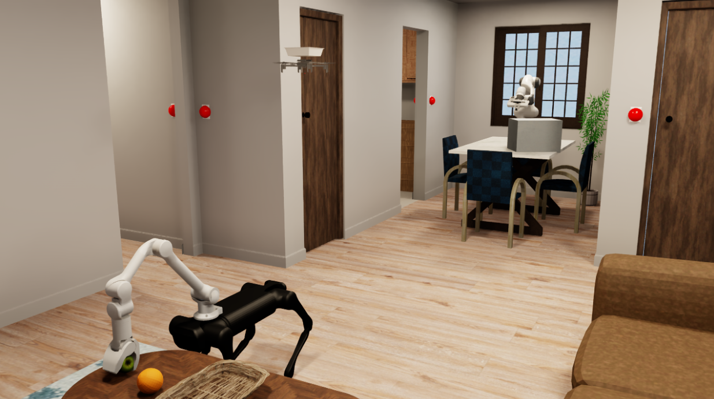
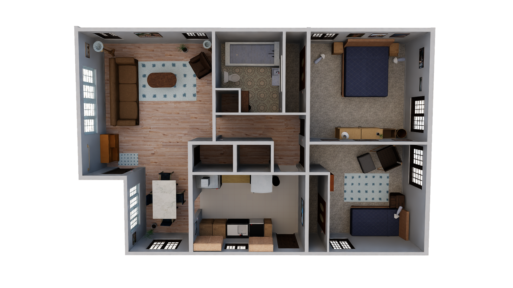

# env0 / task1 首轮场景与资产核对

目标：无人机降落到餐桌上。任务按 task_id=1 选取，源文件中的列表下标为 1。

**当前完成的是任务提取、候选场景核对和资产入口检查。正式三维任务配置尚未生成。** 所有候选均需按本任务初始条件确认，文件存在不代表模型已经加载成功。

## 1. 本次结果

- 保留全部 31 个节点和 34 条初始关系，目标直接涉及无人机 22 和餐桌 13。
- 节点分类：Rooms：4；Floor：4；Doors：3；Furniture：9；Appliances：1；Agents：4；AgentTool：1；Food：1；Office_supplies：1；Toys：1；Tableware：1；Accessories：1。
- 候选底图：Merom_1_int；场景 JSON 有 148 个对象。这些包含墙、地板、家具等，不能与规划节点数直接比较。
- 全模型库扫描 7677 个模型目录，其中 7664 个找到 USD 入口、13 个未找到约定入口。此数字不表示试点任务使用全部模型。
- 根目录与 PEFA 的五份任务文件语义一致：是。共 102 条任务。
- 未启动仿真，未调用规划模型接口。

## 2. 最先要解决的差异

1. **无人机起点不同。** 规划要求在儿童房；演示 cfg 的位置为 `[1.7745543718338013, 7, land_height]`，与 defaults 的客厅地面降落点对应，不能照搬。
2. **规划有两台机械臂。** 演示只有 `franka_0`；卧室中的 `robot_arm_bedroom` 需要独立实例和出生位置。
3. **餐桌的房间标签不同。** 规划餐桌在客厅，候选桌子在场景的 `dining_room_0`。需要明确是否把客餐厅合并为一个规划区域，或改变场景选择/布局。
4. **面包初始位置未给出。** 任务仍包含面包及 HOT 状态，但没有其 ON/INSIDE 关系。不能套用别的任务中的位置。
5. **床的编号不能照抄。** 规划 `bed_0` 在卧室、`bed_1` 在儿童房；候选场景中 `bed_zrumze_1` 才在卧室，`bed_zrumze_0` 在儿童房。
6. **门、篮筐和高台需要单独核对。** 门应按连接房间匹配；篮筐可能已经包含在无人机资产内；高桌必须满足高度和支撑要求。

## 3. 每个节点的对应工作表

候选是待确认建议，不是已确认的复现对应关系。下表只显示少量候选；完整列表见 mapping_candidates.json。

| ID | 物品/区域 | 规划名字 | 初始房间 | 已有场景或演示候选 | 模型库候选数 | 需要处理的事项 |
| --- | --- | --- | --- | --- | --- | --- |
| 0 | 卧室 | bedroom_0 | bedroom_0 | bedroom_0 | 0 | 核对初始关系后确认复用。 |
| 1 | 卧室地面 | bedroom_0_floor | bedroom_0 | floors_rqcmwl_0 | 0 | 核对初始关系后确认复用。 |
| 2 | 儿童房 | childroom_0 | childroom_0 | childs_room_0 | 0 | 核对初始关系后确认复用。 |
| 3 | 儿童房地面 | childroom_0_floor | childroom_0 | floors_nuacoz_0 | 0 | 核对初始关系后确认复用。 |
| 4 | 客厅 | livingroom_0 | livingroom_0 | living_room_0 | 0 | 规划把餐桌归入客厅；场景给餐桌标记 dining_room_0。是否合并为同一规划区域仍需明确。 |
| 5 | 客厅地面 | livingroom_0_floor | livingroom_0 | floors_xzlkei_0 | 0 | 核对初始关系后确认复用。 |
| 6 | 厨房 | kitchen_0 | kitchen_0 | kitchen_0 | 0 | 核对初始关系后确认复用。 |
| 7 | 厨房地面 | kitchen_0_floor | kitchen_0 | floors_hcqtge_0 | 0 | 核对初始关系后确认复用。 |
| 8 | 卧室与客厅之间的门 | Door_0_4 | 未给出 | door_duymuw_0 | 99 | 演示新增门只有候选依据；defaults 中门名称与 articulations 键存在编号差异，需核对连接房间和关闭状态。 |
| 9 | 儿童房与客厅之间的门 | Door_2_4 | 未给出 | door_duymuw_1 | 99 | 需要确认门洞对应关系，并落实 OPEN_FOREVER 初始要求。 |
| 10 | 客厅与厨房之间的通道 | Door_4_6 | 未给出 | door_lvgliq_0; door_lvgliq_1; door_lvgliq_4（另有 6 个） | 99 | 规划为永久开放连接；需要确定实际门洞或通道，不能随便绑定同类门。 |
| 11 | 沙发 | sofa_0 | livingroom_0 | sofa_xhxdqf_0 | 30 | 核对初始关系后确认复用。 |
| 12 | 茶几 | coffeetable_0 | livingroom_0 | coffee_table_fqluyq_0 | 26 | 核对初始关系后确认复用。 |
| 13 | 餐桌 | diningtable_0 | livingroom_0 | breakfast_table_skczfi_0 | 38 | 已有模型、位姿和演示降落点；餐桌实际场景区域为 dining_room_0，规划要求在 livingroom_0，不能忽略此差异。 |
| 14 | 冰箱 | fridge_0 | kitchen_0 | fridge_xyejdx_0 | 11 | 还需确认 CLOSED 状态和盘子在冰箱内的初始放置。 |
| 22 | 无人机 | quadrotor_0 | childroom_0 | quadrotor_0 | 0 | 规划要求在儿童房地面，演示 cfg 的出生位置对应 defaults 的客厅地面降落点；需要重设试点初始位置。 |
| 23 | 机械狗 | aliengo_0 | livingroom_0 | aliengo_0 | 0 | 核对初始关系后确认复用。 |
| 24 | 餐桌上的机械臂 | franka_0 | livingroom_0 | franka_0 | 0 | 核对初始关系后确认复用。 |
| 25 | 无人机携带的篮筐 | quadrotor_0_basket | childroom_0 | 无人机资产中的篮筐（子物体路径待核对） | 0 | 无人机资产名为 cf2x_with_basket.usda；需确认篮筐子物体和绑定方式，不应再无条件新增一个独立篮子。 |
| 26 | 面包 | bread_1 | 未给出 | 未找到直接对应 | 17 | 本任务初始图没有面包的 ON/INSIDE 关系，不能套用 env0/task2 的微波炉位置。还含 HOT 状态。 |
| 27 | 卧室床 | bed_0 | bedroom_0 | bed_zrumze_1 | 28 | 核对初始关系后确认复用。 |
| 28 | 儿童房床 | bed_1 | childroom_0 | bed_zrumze_0 | 28 | 核对初始关系后确认复用。 |
| 32 | 厨房桌 | kitchentable_0 | kitchen_0 | bottom_cabinet_slgzfc_2; bottom_cabinet_slgzfc_3; bottom_cabinet_slgzfc_4 | 129 | 需要在候选台面中选型，并核对 LOW_HEIGHT 要求。 |
| 33 | 卧室高桌 | high_table_bedroom | bedroom_0 | bottom_cabinet_jrhgeu_0; bottom_cabinet_jrhgeu_1; bottom_cabinet_slgzfc_0（另有 1 个） | 160 | 需要明确哪一个可承重、可降落的高台，不能把任意柜子自动当成高桌。 |
| 34 | 儿童房柜子 | cabinet_childroom | childroom_0 | bottom_cabinet_bamfsz_0; bottom_cabinet_dajebq_0 | 101 | 需核对所在房间、容器结构和 CLOSED 状态。 |
| 35 | 厨房高桌 | high_kitchentable_kitchen | kitchen_0 | shelf_owvfik_0; shelf_vgzdul_0 | 93 | 需单独选型和位置，不能与厨房矮桌无依据地合并。 |
| 44 | 儿童房教科书 | Textbook_childroom | childroom_0 | 未找到直接对应 | 1 | 初始应在儿童房床上；即使只有一个模型候选，位置仍需配置。 |
| 45 | 儿童房玩具箱 | Toybox_childroom | childroom_0 | 未找到直接对应 | 14 | 初始应在儿童房地面；需要选择具体型号和开放容器形态。 |
| 50 | 卧室高桌上的第二台机械臂 | robot_arm_bedroom | bedroom_0 | franka_0（只复用模型，需新增实例） | 0 | 演示只含 franka_0 一台机械臂；本节点要有独立实例和出生位置。 |
| 53 | 冰箱里的盘子 | plate_1 | kitchen_0 | 未找到直接对应 | 48 | 需选型号，并在冰箱内部放置；不能只设置在冰箱附近。 |
| 55 | 餐桌上的太阳镜 | sunglasses_0 | livingroom_0 | 未找到直接对应 | 4 | 需选型号并指定桌面位置，检查是否占用无人机降落区域。 |

## 4. 已找到的坐标是什么

场景候选的 position 是底图中物体原有坐标，记录在 mapping_candidates.json。演示中的出生位置和降落点另存于 inventories/reference_coordinates.json。

例如餐桌的物体坐标和无人机降落坐标是两回事：前者用于摆桌子，后者用于让无人机到达桌面上方/表面。不能把桌子的根节点坐标直接当作降落点。

动态表达式以 unresolved_expression 保存。程序没有执行配置中的导入或函数，也没有把缺少的坐标填为零。

下面列出已有坐标的几个候选，便于直接查看。数字为场景原始 root_link 位置，单位按本项目的米制配置理解；它们不是物体表面位置或机器人操作点。表中保留四位小数，完整精度见 JSON。

| 规划物品 | 场景实例 | 实际模型类别/编号 | 原始位置 [X, Y, Z] |
| --- | --- | --- | --- |
| 沙发 | sofa_xhxdqf_0 | sofa/xhxdqf | [3.1177, 9.3441, 0.3463] |
| 茶几 | coffee_table_fqluyq_0 | coffee_table/fqluyq | [3.5979, 7.8162, 0.2598] |
| 餐桌 | breakfast_table_skczfi_0 | breakfast_table/skczfi | [-1.0666, 7.6913, 0.6375] |
| 冰箱 | fridge_xyejdx_0 | fridge/xyejdx | [-0.1852, 3.9132, 0.8273] |
| 卧室床 | bed_zrumze_1 | bed/zrumze | [4.1202, -0.15, 0.4043] |
| 儿童房床 | bed_zrumze_0 | bed/zrumze | [-2.0332, -0.834, 0.3706] |

## 5. 程序检出的具体问题

- 节点 13（餐桌）：候选 breakfast_table_skczfi_0 所在场景房间 ['dining_room_0'] 与规划房间 ['livingroom_0'] 不一致。
- 节点 26（面包）：规划图未说明初始支撑面或容器；需要补充摆放约定。
- 节点 50（卧室高桌上的第二台机械臂）：演示没有这台独立机器人；已有模型可作为新增实例的候选。

底图内未找到约定资产入口的对象：本次未发现。

## 6. 下一步操作顺序

1. 先决定餐桌所属规划区域和儿童房无人机起点；这些会影响本任务的初始布局。
2. 确认两张床、沙发、茶几、冰箱等候选；继续选定高台、柜子与小物品模型。
3. 在工作表中落实门连接、篮筐附属关系，以及缺失的第二台机械臂。
4. 补齐位置和状态后，再生成正式任务配置。服务器可用后检查碰撞、大小、支撑面和降落空间。

## 7. 相关文件

- [完整节点清单](inventories/task_entities.md)
- [完整候选与原始配置依据](mapping_candidates.json)
- [扫描目录、场景和演示配置](inventories/asset_inventory.json)
- [演示坐标原始表达式](inventories/reference_coordinates.json)
- [数据副本对照](inventories/source_audit.json)

### 原项目已有画面：fig1.png

### 原项目已有画面：fig2.png

